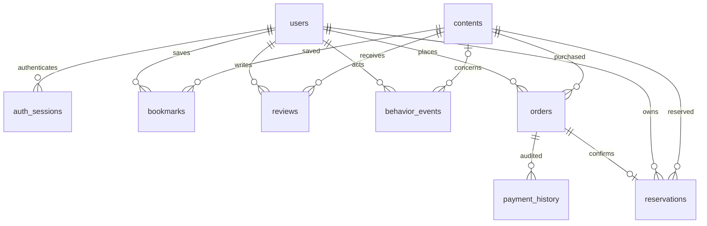

# ERD

`webhook_receipts`는 webhook-id PK와 payment_id 참조 문자열로 중복 수신을 추적한다. 공급자 원본 메시지·카드 정보는 저장하지 않는다. `users`의 categories/tags JSON이 초기 설문 현재 상태다. 실제 적용은 `backend/alembic/versions/`의 이력이며 schema.sql은 참고용이다.

유일 제약: users.email, contents(source,source_id), bookmarks(user_id,content_id), reviews(user_id,content_id), orders(user_id,idempotency_key), reservations.payment_id. 금액·리뷰 범위 CHECK 및 외래키를 DB에서도 강제한다. 사용자/콘텐츠 삭제 시 결제 거래 레코드는 FK로 보호하고 일반 찜·리뷰·세션은 CASCADE, 이벤트 content_id는 SET NULL이다. 회원 탈퇴 기능은 구현하지 않았다.
