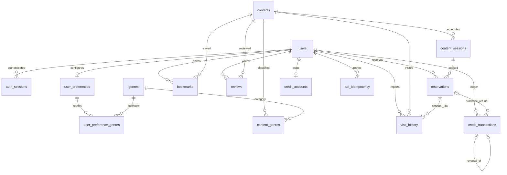
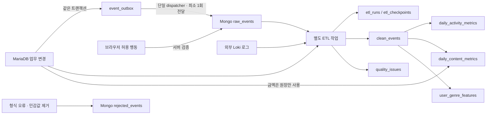

# DB 관계도

표의 정확한 타입·NULL·제약은 [데이터 사전](data-dictionary.md)을 봅니다. FK는 이력 연쇄 삭제를 허용하지 않습니다. outbox의 aggregate_id와 Mongo 참조는 다형성 문자열이므로 SQL FK가 아니며 ETL이 대조합니다.

관계 없는 업무 표: `event_outbox`는 변경 스냅샷 배송 기록, `collection_runs`는 외부 수집 실행 기록입니다. `visit_history.reservation_id+user_id`와 `credit_transactions.reservation_id+user_id`는 복합 FK로 예약 소유자를 검사합니다. 환불 원장도 같은 사용자·예약의 거래만 참조합니다. 원 구매 type/금액은 서비스가 추가 검사합니다.

분석 스키마의 `clean_events.run_id`, `quality_issues.run_id`는 `etl_runs.run_id` FK입니다. 분석 데이터는 늦은 도착·보관·재처리를 고려해 업무 users/contents에 물리 FK를 걸지 않고 정제 단계에서 참조를 검사합니다. `event_id`/`operation_id`/`issue_key`가 재실행 중복을 막습니다.
